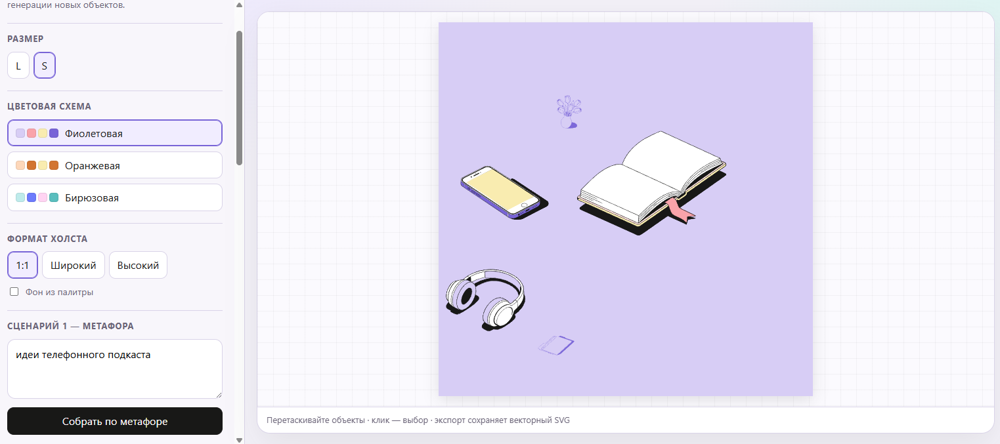
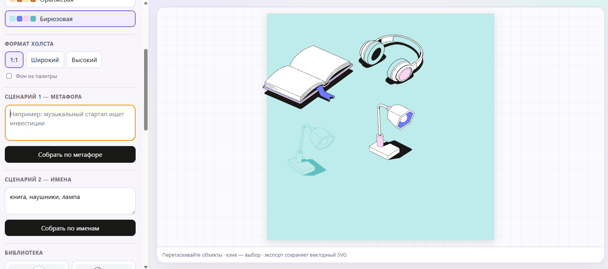

# Конструктор иллюстраций

Многослойный конструктор SVG-иллюстраций с поддержкой композиции объектов по метафоре или набору именованных графических элементов.

**Рабочий сервис:** https://4lister.github.io/illustration-composer-service/ · **Репозиторий:** https://github.com/4lister/illustration-composer-service

---

## 🚀 Быстрый старт

### Установка и запуск

```bash
npm install && npm run dev
```

Откройте `http://localhost:5173` в браузере для просмотра приложения.

---

### Сборка для продакшена

```bash
npm run build
```

После сборки готовый `dist` сжатые файлы (HTML + SVG) находятся в директории `dist/` — их можно развернуть на любом сервере, который может отдавать статический контент.

---

### 🧪 UI-валидация работы фильтра decorative objects

После запуска проекта через `npm run dev` проведите проверку фильтра декоративных объектов:

1. **Откройте** `http://localhost:5173` в браузере.
2. **Создайте композицию** по метафоре, например: `'музыкальный стартап ищет инвестиции'`.
3. **Проверьте слот декоративных объектов**: должны отображаться **только** объекты с ID из списка `['vase', 'block', 'chip', 'lamp', 'folder']`.
4. **Проверьте отсутствие не-декоративных объектов**: объекты `book`, `phone` и другие должны **не появляться** в фоне/декоре.

Это обеспечивает корректную фильтрацию согласно исправлению в `src/lib/compose.ts`.

---

---

## 📁 Архитектура проекта

Проект имеет модульную структуру: __SVG-библиотека__ отделена от логики. Это позволяет легко масштабировать набор графических примитивов и логическое ядро — добавлять новые методы обработки или алгоритмы подбора объектов без изменения друг друга.

```javascript
illustration-constructor/
├── index.html                 # Главный HTML-файл
├── vite.config.ts            # Конфигурация Vite для сборки и препроцессинга SVG
├── tsconfig.json             # Базовый конфиг TypeScript для всего проекта
├── package.json              # Зависимости и скрипты проекта
├── README.md                 # Документация (этот файл)
├── src/
│   ├── main.tsx              # Точка входа приложения — компонент App с состоянием
│   ├── App.tsx               # Корневой компонент: состояние и сценарии сборки
│   ├── index.css             # Глобальные переменные, сброс, базовые стили
│   │
│   ├── components/           # React-компоненты
│   │   ├── Canvas.tsx        # Холст: рендеринг сцены, drag&drop, зум
│   │   ├── Sidebar.tsx       # Панель управления (размер, палитра, формат, сценарии)
│   │   └── SvgObject.tsx     # Отдельный SVG-объект с перекраской
│   │
│   ├── data/
│   │   ├── library.ts        # Конфигурация библиотеки (LIBRARY, FORMATS)
│   │   └── palettes.ts       # Цветовые палитры и карта перекраски исходных цветов
│   │
│   ├── lib/                  # Локальные утилиты (без внешних API)
│   │   ├── compose.ts        # Методики композиции объектов в одну картинку
│   │   ├── exportSvg.ts      # Генерация SVG и скачивание файла
│   │   ├── matchMetaphor.ts  # Алгоритмы подбора объектов по метафоре или именам
│   │   └── recolor.ts        # Перекраска SVG под выбранную палитру
│   │
│   ├── hooks/useSvgAsset.ts  # Загрузка и кеширование SVG-ассетов
│   └── types/index.ts        # Типы данных проекта
├── public/
│   └── library/             # SVG-активы из библиотеки графических примитивов
│       ├── L/ и S/           # Объекты по размерам: main/ — главные, bg/ — фоновые
│       ├── backgrounds/      # Фон под палитры
│       ├── palettes/         # Палитры
│       └── examples/         # Примеры собранных композиций
└── ...                      # Node модули
```

### Ключевые характеристики архитектуры

- __Модульность__: SVG-библиотека (`public/library/`) и бизнес-логика (`src/lib/`) отделены. Легко добавлять новые объекты, подходы к композиции или методы экспорта без изменения друг друга.
- __Типоизирование__: TypeScript используется с целью строгости типов. Все интерфейсы описаны в `src/types/index.ts`.
- __Локальность__: Нет внешних API вызовов — вся логика подбора объектов по метафоре находится локально. Проект работает офлайн после загрузки.
- __Универсальность__: Поддержка экспорта в различных размерах (`square`, `wide`, `tall`), цветовых гаммах (`purple`, `orange`, `teal`) и с фоном/без фона.
- __Расширяемость__: Новые объекты добавляются как SVG-файлы в `public/library/{L,S}/{main,bg}/` + запись в `LIBRARY`; новые палитры — в `PALETTES`. Код при этом не меняется.

---

## 🔧 Установка зависимостей

```bash
npm install
```

> Примечание: используется нативная сборка Vite + React + TypeScript, без Tailwind и других UI-библиотек. Актуальные зависимости указаны в `package.json`.

---

## 📚 Документация API / Модулей

### 1. Точка входа — `src/main.tsx`

Основной файл приложения, запускающий Vite и React приложение:

```typescript
import { render } from 'react-dom/client'
import App from './App.tsx'
import './index.css'

const root = document.getElementById('root')
render(<App />, root)
```

### 2. Приложение — `src/App.tsx`

Компонент приложения с состоянием и рендерингом основных элементов:

- __Состояние__: `size`, `paletteId`, `formatId`, `showBackground`, `metaphor`, `names`, `items`, `selectedUid`.
- __Действия__: Композиция объектов по метафоре (`onComposeMetaphor`) или набору имен (`onComposeNames`).

```typescript
import { useState } from 'react'
// ...

const onComposeMetaphor = () => {
  const objs = matchMetaphor(metaphor, 5)
  if (!objs.length) return alert('Не удалось подобрать объекты по метафоре.')
  setItems(composeObjects(objs, format, { includeBackground: true }))
}
```

### 3. Библиотека объектов — `src/data/library.ts`

Файл с конфигурацией SVG-объектов. Содержит:

- __`FORMATS`__: Наборы размеров для экспорта (`square`, `wide`, `tall`).
- __`LIBRARY`__: Описания объектов из библиотеки (имя, теги для подбора, пропорции).
- __`PALETTES`__ (в `src/data/palettes.ts`): Наборы цветовых палитр и карта перекраски исходных цветов.

```typescript
export const FORMATS: CanvasFormat[] = [
  { id: 'square', name: 'Квадрат', width: 1000, height: 1000 },
  { id: 'wide', name: 'Широкий', width: 1200, height: 630 },
  { id: 'tall', name: 'Высокий', width: 630, height: 1200 },
]

export const LIBRARY: LibraryObject[] = [
  {
    id: 'book',
    name: 'Notebook',
    nameRu: 'Книга',
    tags: ['книга', 'блокнот', 'тетрадь', 'записи', 'учёба', ...],
    width: 1446,
    height: 977,
  },
  // ...
]
```

### 4. Композиция — `src/lib/compose.ts`

Локальная утилита для объединения объектов в одну композицию и вычисления их положений на холсте:

- __Вход__: Массив объектов, формат экспорта, флаг включения фона.
- __Выход__: Состояние CanvasItem с абсолютными позициями каждого объекта.

```typescript
import type { FormatId, LibraryObject } from '../types'

export function composeObjects(objects: Array<LibraryObject>, format: Format, includeBackground: boolean): Array<CanvasItem>
// ... implementation details
```

### 5. Экспорт — `src/lib/exportSvg.ts`

Генерация SVG-контента из состоятельного Canvas и скачивание файла через браузер:

- __Вход__: Состояние Canvas, формат экспорта.
- __Выход__: Методы `buildExportSvg()` (строка с SVG) и `downloadSvg()` (автоматическое скачивание).

```typescript
export function buildExportSvg(canvasState: CanvasItem[], format: Format): string

export function downloadSvg(svgContent: string, filename: string)
// ... implementation details
```

### 6. Подбор объектов — `src/lib/matchMetaphor.ts`

Локальные алгоритмы подбора объектов по метафоре или набору имен (без внешнего API):

- __`matchMetaphor`__: Находит объекты из библиотеки, соответствующие заданной метафоре.
- __`matchNames`__: По именованным графическим элементам (например: `книга`, `наушники`).

```typescript
export function matchMetaphor(metaphor: string, maxObjects: number): Array<LibraryObject>
export function matchNames(names: string): Array<LibraryObject>
// ... implementation details
```

### 7. Перекраска — `src/lib/recolor.ts`

Перевод SVG-объекта из исходной (фиолетовой) палитры в выбранную цветовую схему:

- __`recolorSvg`__: Заменяет цвета заливки/обводки по карте ролей `SOURCE_COLOR_ROLES` на цвета активной палитры.
- __`injectSvgRootAttrs`__: Подготавливает корневой `<svg>` для встраивания в общую композицию.
- __`stripXmlNsNoise`__: Убирает XML-декларацию и DOCTYPE при встраивании.

```typescript
export function recolorSvg(svgText: string, palette: Palette, mode: 'main' | 'bg' = 'main'): string
export function injectSvgRootAttrs(svgText: string, attrs: Record<string, string>): string
export function stripXmlNsNoise(svgText: string): string
```

### 8. Типы — `src/types/index.ts`

Декларация типов данных:

- __`CanvasItem`__: Элемент холста с абсолютными позициями, масштабом, поворотом и z-индексом.
- __`FormatId`__: ID формата экспорта (`square`, `wide`, `tall`).
- __`LibraryObject`__: Описание объекта из библиотеки (id, имена, теги, пропорции).
- __`PaletteId`__: ID цветовой палитры (`purple`, `orange`, `teal`).
- __`SizeId`__: Размер объектов (`L`, `S`).
- __`VariantId`__: Вариант объекта: `main` (главный, цветной) или `bg` (фоновый, монохромный).

```typescript
export type CanvasItem = { uid: string; objectId: string; variant: VariantId; x: number; y: number; ... }
export type FormatId = 'square' | 'wide' | 'tall'
export type LibraryObject = { id: string; name: string; nameRu: string; tags: string[]; ... }
// ...
```

---

## ⚙️ Конфигурация Vite и TypeScript

### `vite.config.ts`

Конфигурация сборочного инструмента:

- __Плагин__: `@vitejs/plugin-react` для JSX и Fast Refresh.
- __Ассеты__: SVG-библиотека хранится в `public/library/` и загружается в рантайме через `fetch` (с кешированием в `useSvgAsset`), поэтому файлы остаются оригинальными и редактируемыми.

```typescript
import react from '@vitejs/plugin-react'
import { defineConfig } from 'vite'

// https://vite.dev/config/
export default defineConfig({
  plugins: [react()],
})
```

### `tsconfig.json`

Базовая конфигурация TypeScript для всего проекта:

- __Цель компиляции__: ES2023.
- __Сборка__: Используется режим bundler (`moduleResolution: 'bundler'`).
- __Строгость типов__: Включены строгие правила без неопределённых имен и параметров.

```json
{
  "compilerOptions": {
    "target": "ES2023",
    "lib": ["ES2023", "DOM"],
    "module": "esnext",
    "moduleResolution": "bundler",
    "allowImportingTsExtensions": true,
    "strict": true,
    "noUnusedLocals": true,
    "noUnusedParameters": true,
    "verbatimModuleSyntax": true,
    "esModuleInterop": true,
    "skipLibCheck": true
  },
  "include": ["src/**/*"],
  "exclude": ["node_modules"]
}
```

### `tsconfig.app.json` и `tsconfig.node.json`

Отдельные файлы для точечной сборки:

- __`tsconfig.app.json`__: Конфигурация для компонентов React (`src/`).
- __`tsconfig.node.json`__: Конфигурация для конфигурационных файлов проекта (например, `vite.config.ts`).

---

## 🎨 Настройки композиции

### Цветовые палитры

- __`purple`__: Фиолетовая гамма с теплыми оттенками.
- __`orange`__: Оранжевая палитра для энергичных иллюстраций.
- __`teal`__: Бирюзовая комбинация для современных дизайнов.

Каждая палитра включает основные и акцентные цвета, а также фоновые оттенки и текст на фоне.

### Размеры объектов

- __`L` (Large)__: Большие объекты — подходят в качестве фонового элемента или центрального объекта композиции.
- __`S` (Small)__: Маленькие элементы — используются для дополнительных деталей.

---

## 🔧 Использование API / модулей

### Пример: Создать композицию по метафоре



```typescript
// Включим метаданные в App.tsx
const metaphor = 'идеи телефонного подкаста'

// Подбор объектов
const objs = matchMetaphor(metaphor, 5) // maxObjects=5

// Композиция в выбранном формате
const items = composeObjects(objs, format, { includeBackground: true })

// Скачивание готового SVG
const svg = await buildExportSvg({ items, format, size, paletteId, background: true })
downloadSvg(svg, 'investiture.svg')
```

### Пример: Создать композицию по именам



```typescript
const names = 'книга, наушники, лампа'
const objs = matchNames(names) // Поиск объектов с данными именами
const items = composeObjects(objs, format, { includeBackground: true })
```

---

## 📦 Форматирование и линтинг

Проект включает в себя строгие правила линтера TypeScript:

- __`noUnusedLocals`__: Неопределённые переменные вызывают ошибку.
- __`noUnusedParameters`__: Без использования параметры вызовут компиляцию с ошибкой.
- __`verbatimModuleSyntax`__: Использование `import/export` без синтаксической трансформации.

---

## 🤖 AI-инструменты, использованные при разработке

При разработке использовались AI-ассистенты:

- **Cursor / Windsurf** — AI-редакторы кода: написание и рефакторинг модулей, работа с компонентами и типами.
- **OpenCode** — автоматизация сценариев разработки, генерация и отладка кода.
- **Cline + Qwen3.5** — AI-агент для доработки логики подбора объектов, перекраски и экспорта.

> Логика сервиса (подбор объектов, композиция, перекраска, экспорт) — собственная и работает локально, без внешних API. AI-инструменты применялись только как помощники при разработке.

---

## 🛠️ Развертывание

Сборка проекта выполняется автоматически через Vite:

```bash
npm run build
```

После сборки в директории `dist/` находятся:

- __`index.html`__ — готовый HTML с подключенными стилями и скриптом.
- __`/library/**`__ — SVG-ассеты библиотеки (объекты, фоны, палитры, примеры).

Проект — статическое одностраничное приложение, поэтому разворачивается на любом хостинге статического контента:

- **GitHub Pages** — через Actions (`.github/workflows/deploy.yml`) или вручную из папки `dist/`.
- **Netlify / Vercel** — команда сборки `npm run build`, директория публикации `dist`.
- **Любой статический сервер** — `npm run preview` (Vite Preview) или `npx serve dist`.

> При публикации в подпапку (например, GitHub Pages для репозитория) укажите `base: '/<имя-репозитория>/'` в `vite.config.ts`.
